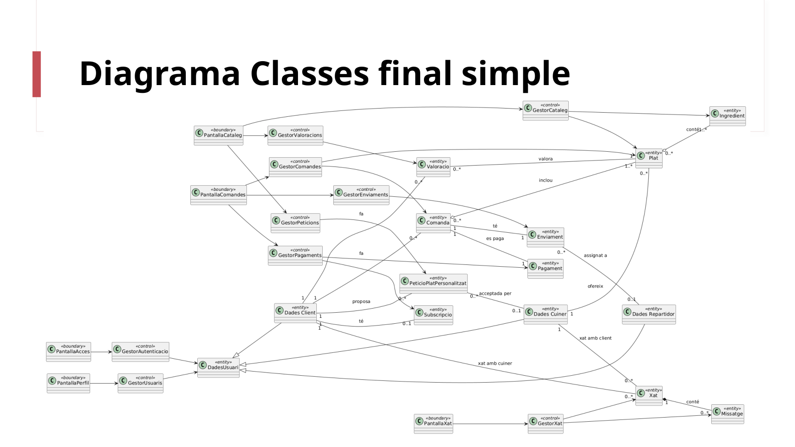
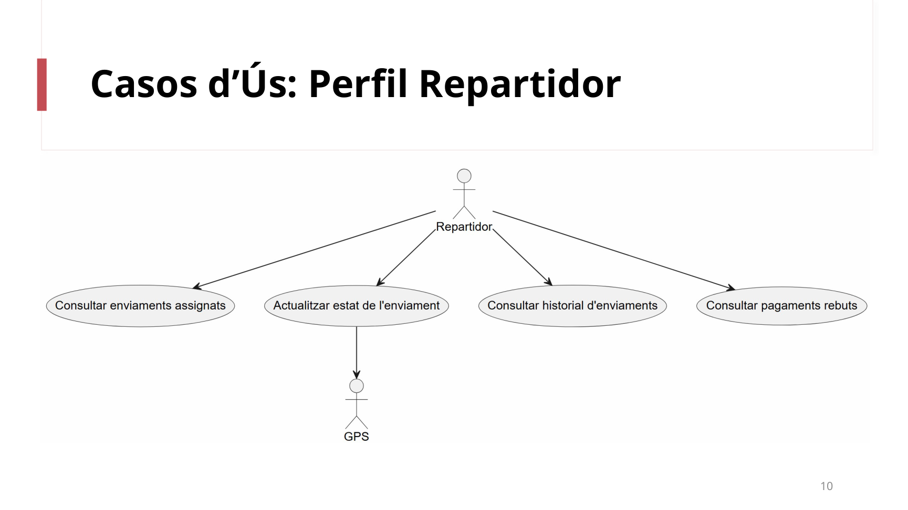
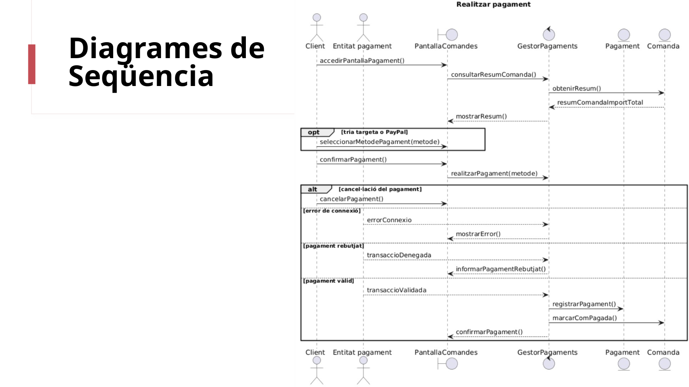

# QueMenges — Software Requirements & UML Design

**Software Engineering · Universitat Autònoma de Barcelona (UAB) · 2025–2026 · Team of 4**

QueMenges is an academic software engineering project focused on the **requirements analysis and UML design** of a proposed platform connecting customers with independent cooks and delivery couriers.

> **Project scope:** This repository presents requirements and system-design deliverables, **not a deployed or executable application**. The project was completed collaboratively as part of a university course.

## Project overview

The proposed platform allows customers to discover meals prepared by independent cooks, place orders, select delivery or pickup options, and rate their experience. Its design considers three main roles:

- **Customers:** browse dishes, filter by dietary needs, place orders, choose delivery methods, and manage payments.
- **Cooks:** publish meals, manage availability, and handle customer requests.
- **Couriers:** consult assigned deliveries, update delivery status, and view completed deliveries and payments.

Additional requirements cover user accounts, personalized meal requests, messaging, subscriptions, and non-functional constraints.

## What we produced

- **37 documented functional and non-functional requirements**, organized by identifier and linked in a [requirements index](docs/requirements-index.md).
- **UML use-case diagrams** covering the different user roles.
- **Use-case specifications**, including main flows and alternative scenarios.
- **UML class and sequence diagrams** describing system structure and interactions.
- **Iterative team coordination** through four Scrum sprints and sprint reviews.

## Selected UML diagrams

### UML class diagram

The final simplified class diagram models core entities, interfaces, controllers, and relationships across ordering, deliveries, payments, and messaging.



### Courier use-case diagram

A role-based view showing the courier's main interactions with the proposed system.



### Payment sequence diagram

An example of interaction modeling, including successful payment and alternative flows such as rejection or cancellation.



## My contributions

My documented responsibilities across the four sprints included:

| Sprint | Contribution |
| --- | --- |
| 1 — Requirements | Analyzed the group 6 requirements and additional system considerations. |
| 2 — Use cases | Created the courier use-case diagram and collaborated on requirement corrections. |
| 3 — Specifications & class model | Served as **Scrum Master**; wrote courier use-case specifications; contributed to customer use-case specifications; created the class diagram and burn-down chart for the sprint. |
| 4 — Sequence diagrams | Produced **eight UML sequence diagrams** and participated in team tracking and updates. |

For more context, see [my contributions](docs/contributions.md). The overall project deliverables were produced by a four-person team.

## Repository structure

```text
.
├── README.md
├── assets/
│   ├── class-diagram.png
│   ├── courier-use-cases.png
│   └── payment-sequence.png
├── docs/
│   ├── contributions.md
│   └── requirements-index.md
└── requirements/
    └── RF-*.md and RNF-*.md (37 requirement specifications)
```

## Methods and tools

**Requirements engineering · UML modeling · Scrum · Git/GitHub · Trello**

This is a documentation and design repository. There are no dependencies to install or commands to run; start with the [requirements index](docs/requirements-index.md) and the diagrams above.

## Academic context and authorship

Developed by a **team of four students** for the Software Engineering course at the Universitat Autònoma de Barcelona, academic year 2025–2026. This repository is a curated portfolio presentation of the collaborative academic work, highlighting my own contributions. UML figures and requirements originated from the team project.
